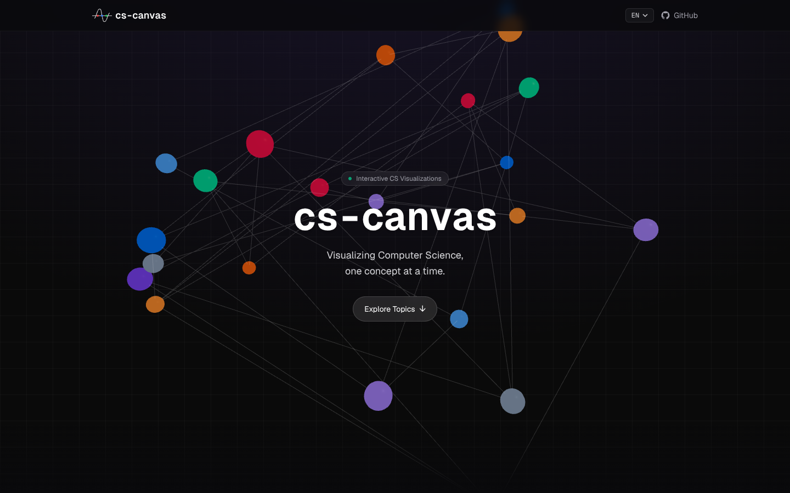

# cs-canvas

Interactive visualizations of computer science: run an algorithm, step through it, and see why each step happens.
Covers algorithms, data structures, operating systems, networks, databases and computer architecture.

**Live:** https://cs-canvas.vercel.app



## Install

```sh
npm install
npm run dev
```

Then open http://localhost:3000.

## Structure

```
src/app/(topics)/   one folder per topic and lesson (algorithms, data-structures, operating-systems, ...)
src/components/     visualizations and shared UI
src/contexts/       language setting
```
